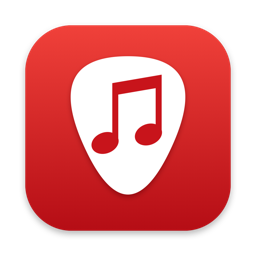
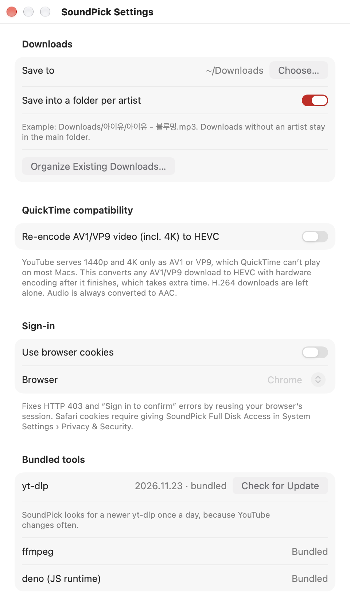

# SoundPick

[한국어](README.md) | English

A media downloader for macOS. Search for a song or paste a link, and SoundPick saves it as MP3, M4A or MP4, fills in the tags and album art, and files it into artist and album folders. It is a native SwiftUI app, and the tools it needs (yt-dlp, ffmpeg, deno) are inside the app, so there is nothing else to install.

> Use it only for content you have the right to download. Following each site's terms of service and copyright law is your responsibility.

<p>
  
  
</p>

The video in the screenshots is *Big Buck Bunny*, an open short film by the Blender Foundation.

## Features

- **Search and links**: search YouTube by title, paste a link (⌘V), or drop one onto the window. Search covers YouTube only. Links to other sites yt-dlp supports (Vimeo, TikTok and so on) can be used too, but sites other than YouTube have not been tested much.
- **Albums and playlists**: the tracks are listed, and the ticked ones download in one go. Each track can have its own format, tags and cover.
- **Formats**: MP3 or M4A for audio, MP4 for video (360p to 4K).
- **Tags and album art**: title, artist, album, year and genre are filled in and can be edited. Album art is found on iTunes for you to pick, or the video thumbnail is used.
- **Automatic filing**: files are saved as `Artist/Artist - Title.mp3`, and album tracks as `Artist/Album/01 - Title.mp3`.
- **Preview**: play the audio or a 360p video before downloading.
- **QuickTime compatibility**: an option re-encodes AV1/VP9 video (1440p, 4K) to HEVC.
- **Organize existing files**: sorts loose files in the download folder into folders by the artist in their tags.
- **yt-dlp updates itself**: once a day the app looks for a newer version and installs it. No rebuild needed.

## Requirements

- macOS 13 or later
- Xcode (Swift 5.9 or later)
- [XcodeGen](https://github.com/yonaskolb/XcodeGen): `brew install xcodegen`
- ffmpeg from [Homebrew](https://brew.sh): `brew install ffmpeg` (the copy that goes into the app is taken from here)

## Building

The bundled tools (about 330 MB) are not in the repository. Fetch them once first.

```bash
scripts/download-deps.sh
```

```bash
xcodegen generate
```

```bash
xcodebuild -scheme PullTube -configuration Debug build
```

The built app appears at `~/Library/Developer/Xcode/DerivedData/PullTube-*/Build/Products/Debug/SoundPick.app`. You can also open `PullTube.xcodeproj` in Xcode and run it there.

`download-deps.sh` downloads yt-dlp and deno from each project's GitHub releases, copies ffmpeg and its libraries from Homebrew, and puts them in `Sources/PullTube/Resources/Vendored`.

## Usage

1. Type a song title in the search field and press Return, or copy a link and press ⌘V.
2. Pick a track in the list on the left. Its cover and tags appear on the right.
3. Choose Audio or Video and a format, and edit the tags and album art if you like.
4. Press **Download**. In an album, every ticked track is downloaded.

The download folder, per-artist folders, HEVC re-encoding and browser cookies are set in Settings (⌘,). The default download folder is Downloads.



## How it behaves

- **Nothing half-done is left behind.** A download works in a hidden temporary folder inside the download folder, and only a file that is complete and tagged comes out. Cancelling, or the app quitting, leaves no partial files.
- **yt-dlp updates are verified before they are installed.** The download is checked against the SHA-256 the release publishes and is test-run, then installed in `~/Library/Application Support/SoundPick/yt-dlp/`. The copy inside the app stays as a fallback.
- **Videos that need a sign-in** can be downloaded by turning on browser cookies in Settings. Using Safari's cookies requires giving the app Full Disk Access.

## Layout

```text
Sources/PullTube/
  PullTubeApp.swift     app entry point
  Models/               screen state, download items, tags, preview
  Services/             running yt-dlp, updates, conversion, tag writing, album art search
  Views/                the interface (colours, spacing and type live in Theme.swift)
  Resources/            icons, Vendored (bundled tools, not in git)
scripts/
  download-deps.sh      fetch the bundled tools
  make-icon.sh          draw the app icon (make-icon.swift draws it in code)
project.yml             XcodeGen settings
```

## About the name

The app is called SoundPick, but the target, scheme, source folder and bundle identifier keep the original name, PullTube, so that saved settings carry over.

## Distribution

This is a personal build that is neither signed with a developer certificate nor notarized (ad-hoc signing). On another Mac, Gatekeeper will block it.

## Launch options for development

Debug builds include launch options that set up a particular state without clicking through the interface. They are not part of release builds. Pass them as arguments to the executable.

```bash
APP=$(ls -d ~/Library/Developer/Xcode/DerivedData/PullTube-*/Build/Products/Debug/SoundPick.app | head -1)
"$APP/Contents/MacOS/SoundPick" -openLink "https://www.youtube.com/watch?v=aqz-KE-bpKQ" -openFormat 1080 -snapshotTo /tmp/shot.png -snapshotDelay 10
```

<details>
<summary>All options</summary>

**Loading and driving the interface**

| Option | What it does |
|---|---|
| `-openLink <link or search text>` | Opens a link or runs a search at launch. With this option the format choice is not saved. |
| `-openFormat mp3\|m4a\|<height>` | Chooses the format. A number is a video height (`360`, `1080`, `2160`). |
| `-uncheck "2,4"` | Unticks those track numbers in an album or playlist. |
| `-checkOnly "1,3"` | Ticks only those track numbers. |
| `-debugEdit YES` | Changes track 3's title and cover, to show the "edited" mark. |
| `-artQuery <text>` | Searches for album art with that text. |
| `-openArtViewer YES` | Opens the large view of the chosen album art. |
| `-autoPreview YES` | Starts a muted preview 4 seconds after loading. |
| `-clickSearch <seconds>` | Clicks the search field once after that long. |
| `-clickSearchTwice YES` | Clicks it again a second later. |

**Downloads**

| Option | What it does |
|---|---|
| `-autoDownload YES` | Downloads the track shown. |
| `-autoDownloadAll YES` | Downloads every ticked track. |
| `-autoCancelInDownloading YES` | Presses Cancel part-way through the download (after 30%). |
| `-autoCancelInProcessing YES` | Presses Cancel once the conversion or tag-writing step starts. |
| `-autoCancelDelayMs <milliseconds>` | Pause before pressing Cancel (default 300). |

**Settings window and Organize sheet**

| Option | What it does |
|---|---|
| `-openSettings YES` | Opens the Settings window. |
| `-openOrganizer YES` | Opens the Organize sheet from Settings. |
| `-organizeFolder <path>` | Points the Organize sheet at this folder instead of the download folder. |
| `-organizerAutoMove YES` | Moves the selected files at once. Works only together with `-organizeFolder`. |

**yt-dlp updates**

| Option | What it does |
|---|---|
| `-ytdlpCheckNow YES` | Checks now, even if a day has not passed. |
| `-ytdlpPretendVersion <version>` | Treats the yt-dlp inside the app as that version (for example `2020.01.01`). |
| `-ytdlpUpdateFolder <path>` | Installs updates in this folder instead of Application Support. |

**Screenshots**

| Option | What it does |
|---|---|
| `-snapshotTo <file.png>` | Saves a picture of the window and quits. The Settings window is saved as `…-settings.png` and a sheet as `…-sheet.png`. |
| `-snapshotDelay <seconds>` | How long to wait before saving (at least 1). |
| `-snapshotAppearance light\|dark` | Takes the picture in light or dark mode. |
| `-snapshotActivate YES` | Brings the app to the front first. |

**Useful alongside**

- Saved settings can be overridden for one run the same way, for example `-downloadFolder /tmp/test` or `-reencodeToHEVC YES`. The saved values are not changed.
- `-ApplePersistenceIgnoreState YES` ignores the window state macOS remembered. It is needed when the main window does not appear after the app was force-quit.
- For a picture of an active window, launch with `open -W -n SoundPick.app --args …` instead of running the executable directly.

</details>

## License

The source code in this repository is released under the [MIT License](LICENSE).

The tools the app bundles follow their own licenses and are not part of this repository: [yt-dlp](https://github.com/yt-dlp/yt-dlp) (Unlicense), [FFmpeg](https://ffmpeg.org) (LGPL/GPL, depending on the build), [Deno](https://deno.com) (MIT). If you distribute a built app to others, their terms apply as well.
