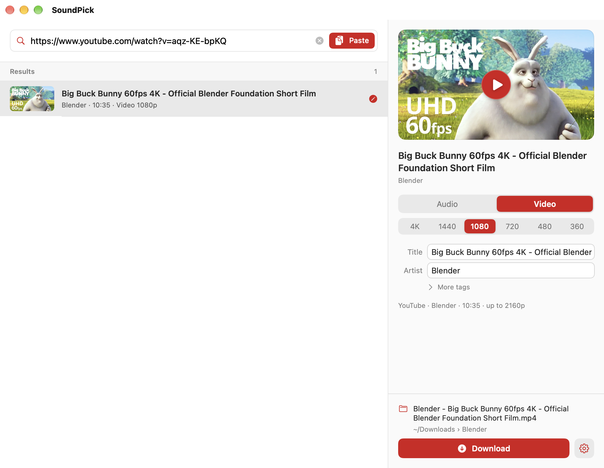
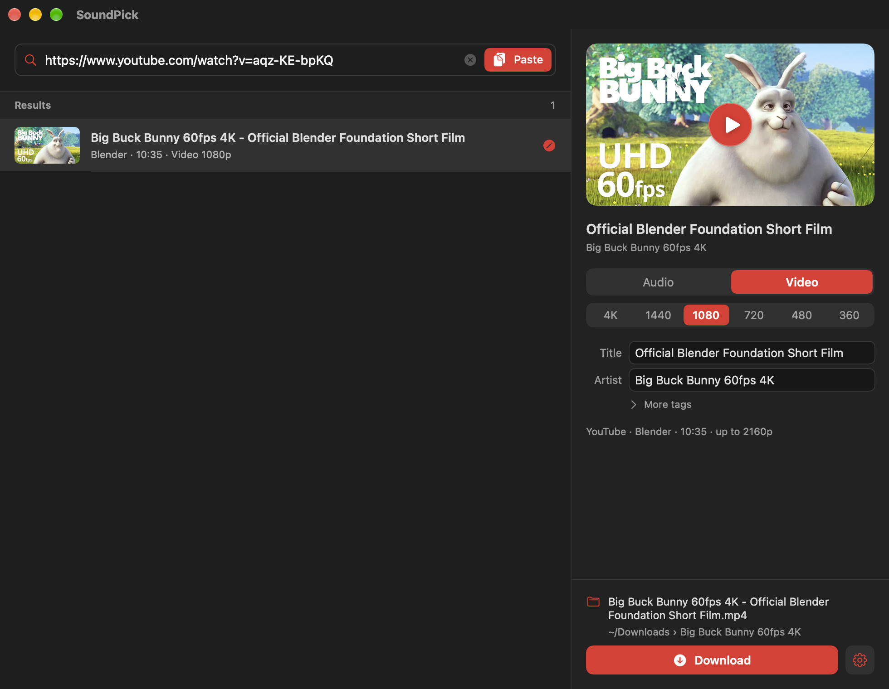

# SoundPick

[한국어](README.md) | English

A media downloader for macOS. Search for a song or paste a link, and SoundPick saves it as MP3, M4A or MP4, fills in the tags and album art, and files it into artist and album folders. It is a native SwiftUI app, and the tools it needs (yt-dlp, ffmpeg, deno) are inside the app, so there is nothing else to install.

> Use it only for content you have the right to download. Following each site's terms of service and copyright law is your responsibility.

<p>
  
  
</p>

The video in the screenshots is *Big Buck Bunny*, an open short film by the Blender Foundation.

## Features

- **Search and links**: search YouTube by title, paste a link (⌘V), or drop one onto the window. Search covers YouTube only. Links to other sites yt-dlp supports (Vimeo, TikTok and so on) can be used too, but sites other than YouTube have not been tested much.
- **Albums and playlists**: the tracks are listed, and the ticked ones download in one go. Each track can have its own format, tags and cover.
- **Formats**: MP3 or M4A for audio, MP4 for video (360p to 4K).
- **Tags and album art**: title, artist, album, year and genre are filled in and can be edited. Album art is found on iTunes for you to pick, or the video thumbnail is used.
- **Automatic filing**: files are saved as `Artist/Artist - Title.mp3`, and album tracks as `Artist/Album/01 - Title.mp3`.
- **Preview**: play the audio or a 360p video before downloading.
- **QuickTime compatibility**: an option re-encodes AV1/VP9 video (1440p, 4K) to HEVC.
- **Organize existing files**: sorts loose files in the download folder into folders by the artist in their tags.
- **yt-dlp updates itself**: once a day the app looks for a newer version and installs it. No rebuild needed.

## Requirements

- macOS 13 or later
- Xcode (Swift 5.9 or later)
- [XcodeGen](https://github.com/yonaskolb/XcodeGen): `brew install xcodegen`
- ffmpeg from [Homebrew](https://brew.sh): `brew install ffmpeg` (the copy that goes into the app is taken from here)

## Building

The bundled tools (about 330 MB) are not in the repository. Fetch them once first.

```bash
scripts/download-deps.sh
```

```bash
xcodegen generate
```

```bash
xcodebuild -scheme PullTube -configuration Debug build
```

The built app appears at `~/Library/Developer/Xcode/DerivedData/PullTube-*/Build/Products/Debug/SoundPick.app`. You can also open `PullTube.xcodeproj` in Xcode and run it there.

`download-deps.sh` downloads yt-dlp and deno from each project's GitHub releases, copies ffmpeg and its libraries from Homebrew, and puts them in `Sources/PullTube/Resources/Vendored`.

## Usage

1. Type a song title in the search field and press Return, or copy a link and press ⌘V.
2. Pick a track in the list on the left. Its cover and tags appear on the right.
3. Choose Audio or Video and a format, and edit the tags and album art if you like.
4. Press **Download**. In an album, every ticked track is downloaded.

The download folder, per-artist folders, HEVC re-encoding and browser cookies are set in Settings (⌘,). The default download folder is Downloads.


## How it behaves

- **Nothing half-done is left behind.** A download works in a hidden temporary folder inside the download folder, and only a file that is complete and tagged comes out. Cancelling, or the app quitting, leaves no partial files.
- **yt-dlp updates are verified before they are installed.** The download is checked against the SHA-256 the release publishes and is test-run, then installed in `~/Library/Application Support/SoundPick/yt-dlp/`. The copy inside the app stays as a fallback.
- **Videos that need a sign-in** can be downloaded by turning on browser cookies in Settings. Using Safari's cookies requires giving the app Full Disk Access.

## Layout

```text
Sources/PullTube/
  PullTubeApp.swift     app entry point
  Models/               screen state, download items, tags, preview
  Services/             running yt-dlp, updates, conversion, tag writing, album art search
  Views/                the interface (colours, spacing and type live in Theme.swift)
  Resources/            icons, Vendored (bundled tools, not in git)
scripts/
  download-deps.sh      fetch the bundled tools
  make-icon.sh          build the app icon from Design/icon-source.png
project.yml             XcodeGen settings
```

## About the name

The app is called SoundPick, but the target, scheme, source folder and bundle identifier keep the original name, PullTube, so that saved settings carry over.

## Distribution

This is a personal build that is neither signed with a developer certificate nor notarized (ad-hoc signing). On another Mac, Gatekeeper will block it.
