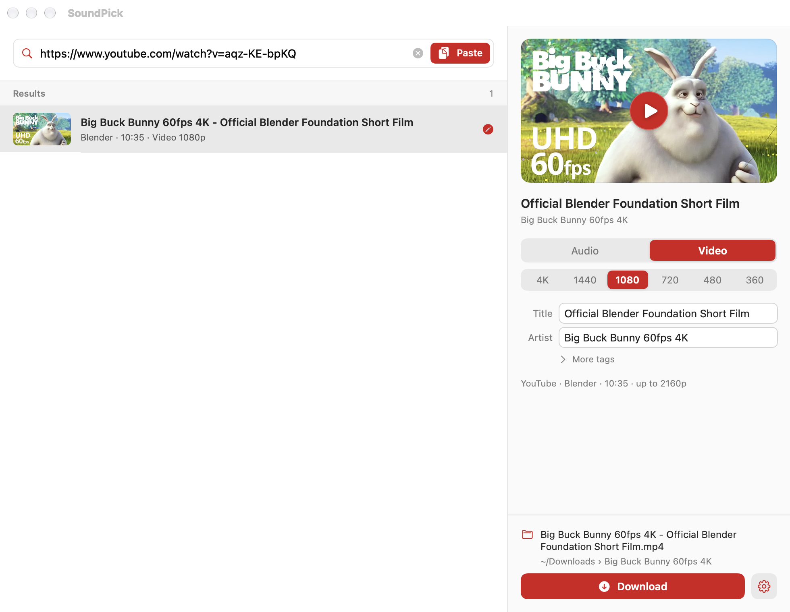
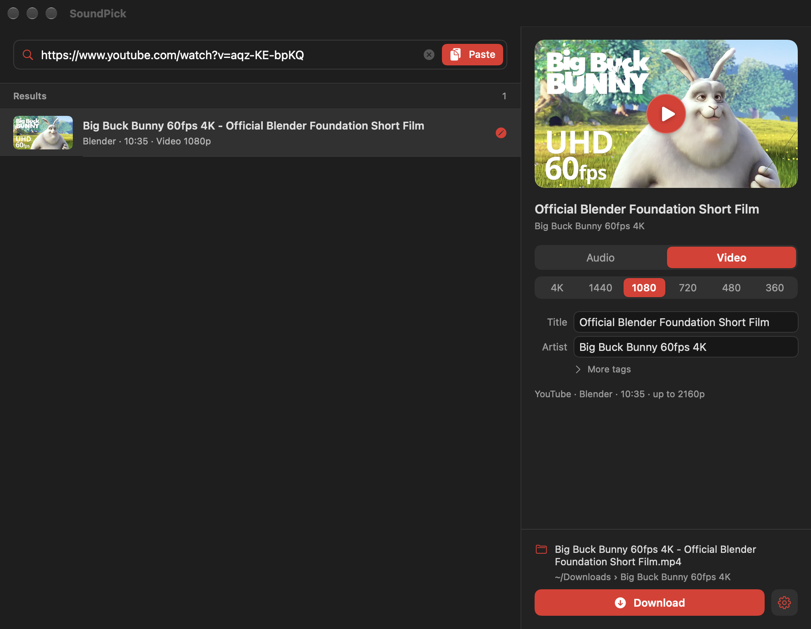
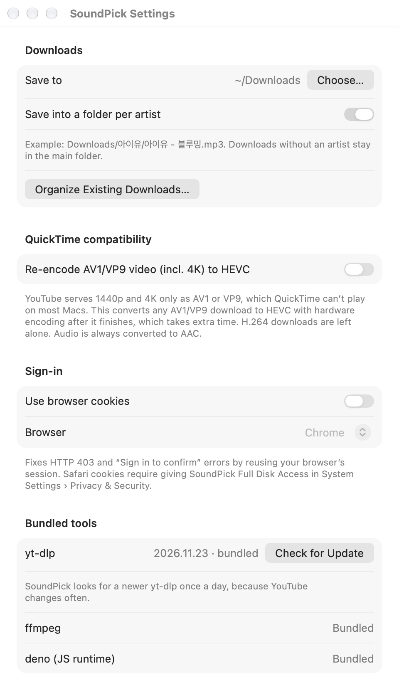

# SoundPick

macOS용 미디어 다운로더입니다. 노래를 검색하거나 링크를 붙여 넣으면 MP3, M4A, MP4로 받아 태그와 앨범 아트를 넣고 가수·앨범 폴더에 정리해 줍니다. SwiftUI로 만든 네이티브 앱이고, 필요한 도구(yt-dlp, ffmpeg, deno)는 앱 안에 들어 있어 따로 설치할 것이 없습니다.

> 받을 권리가 있는 콘텐츠에만 사용하세요. 각 사이트의 이용 약관과 저작권법을 지킬 책임은 사용자에게 있습니다.

<p>
  
  
</p>

화면 속 영상은 Blender Foundation의 공개 단편 *Big Buck Bunny*입니다.

## 기능

- **검색과 링크**: 제목으로 YouTube를 검색하거나, 링크를 붙여 넣거나(⌘V), 창에 끌어다 놓습니다. 검색은 YouTube만 지원하고, 링크는 yt-dlp가 지원하는 다른 사이트(Vimeo, TikTok 등)도 넣을 수 있지만 YouTube 외에는 충분히 시험하지 않았습니다.
- **앨범과 재생목록**: 곡 목록이 나오고, 체크한 곡만 한 번에 받습니다. 곡마다 형식·태그·커버를 따로 바꿀 수 있습니다.
- **형식**: 오디오는 MP3 또는 M4A, 영상은 MP4(360p ~ 4K).
- **태그와 앨범 아트**: 제목·가수·앨범·연도·장르를 채워 주고 직접 고칠 수 있습니다. 앨범 아트는 iTunes에서 찾아 고르거나 영상 썸네일을 씁니다.
- **자동 정리**: `가수/가수 - 제목.mp3`, 앨범 곡은 `가수/앨범/01 - 제목.mp3`로 저장합니다.
- **미리듣기**: 받기 전에 오디오나 360p 영상을 재생해 봅니다.
- **QuickTime 호환**: AV1/VP9 영상(1440p, 4K)을 HEVC로 다시 인코딩하는 옵션이 있습니다.
- **기존 파일 정리**: 저장 폴더에 흩어진 파일을 태그의 가수 이름으로 폴더에 나눠 담습니다.
- **yt-dlp 자동 업데이트**: 하루에 한 번 새 버전을 확인해 설치합니다. 앱을 다시 빌드하지 않아도 됩니다.

## 필요한 것

- macOS 13 이상
- Xcode (Swift 5.9 이상)
- [XcodeGen](https://github.com/yonaskolb/XcodeGen): `brew install xcodegen`
- [Homebrew](https://brew.sh)의 ffmpeg: `brew install ffmpeg` (앱에 넣을 사본을 여기서 가져옵니다)

## 빌드

번들 도구(약 330 MB)는 저장소에 들어 있지 않습니다. 처음 한 번 받아야 합니다.

```bash
scripts/download-deps.sh
```

```bash
xcodegen generate
```

```bash
xcodebuild -scheme PullTube -configuration Debug build
```

빌드된 앱은 `~/Library/Developer/Xcode/DerivedData/PullTube-*/Build/Products/Debug/SoundPick.app`에 생깁니다. Xcode에서 `PullTube.xcodeproj`를 열어 실행해도 됩니다.

`download-deps.sh`는 yt-dlp와 deno를 각 프로젝트의 GitHub releases에서 받고, ffmpeg와 그 라이브러리를 Homebrew에서 복사해 `Sources/PullTube/Resources/Vendored`에 넣습니다.

## 사용법

1. 검색창에 노래 제목을 입력하고 Return을 누르거나, 링크를 복사한 뒤 ⌘V를 누릅니다.
2. 왼쪽 목록에서 곡을 고르면 오른쪽에 커버와 태그가 나옵니다.
3. Audio/Video와 형식을 고르고, 필요하면 태그와 앨범 아트를 고칩니다.
4. **Download**를 누릅니다. 앨범에서는 체크한 곡을 모두 받습니다.

저장 위치, 가수별 폴더, HEVC 재인코딩, 브라우저 쿠키 사용은 설정(⌘,)에서 바꿉니다. 기본 저장 위치는 다운로드 폴더입니다.



## 동작에 대해

- **중간에 끊겨도 깨끗합니다.** 다운로드는 저장 폴더 안의 숨김 임시 폴더에서 진행되고, 태그까지 다 쓴 파일만 밖으로 나옵니다. 취소하거나 앱이 종료돼도 만들다 만 파일이 남지 않습니다.
- **yt-dlp 업데이트는 검증 후 설치합니다.** 배포처가 공개한 SHA-256과 대조하고 실제로 실행해 본 뒤 `~/Library/Application Support/SoundPick/yt-dlp/`에 설치합니다. 앱 안의 사본은 예비로 남습니다.
- **로그인이 필요한 영상**은 설정에서 브라우저 쿠키 사용을 켜면 받을 수 있습니다. Safari 쿠키를 쓰려면 앱에 전체 디스크 접근 권한이 필요합니다.

## 폴더 구조

```text
Sources/PullTube/
  PullTubeApp.swift     앱 진입점
  Models/               화면 상태, 다운로드 항목, 태그, 미리듣기
  Services/             yt-dlp 실행, 업데이트, 변환, 태그 쓰기, 앨범 아트 검색
  Views/                화면 (Theme.swift에 색·간격·글자 기준)
  Resources/            아이콘, Vendored(번들 도구, git 제외)
scripts/
  download-deps.sh      번들 도구 받기
  make-icon.sh          Design/icon-source.png로 앱 아이콘 만들기
project.yml             XcodeGen 설정
```

## 이름에 대해

앱 이름은 SoundPick이지만 타깃, 스킴, 소스 폴더, 번들 ID는 처음 이름인 PullTube를 그대로 씁니다. 저장된 설정을 이어 쓰기 위해서입니다.

## 배포

서명과 공증을 하지 않은 개인용 빌드입니다(ad-hoc 서명). 다른 Mac으로 옮기면 Gatekeeper가 실행을 막습니다.
